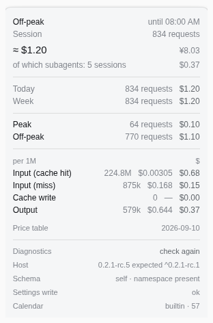

# dsh-peak-cost

[](https://github.com/korotky/dsh-peak-cost/actions/workflows/ci.yml)
[](https://www.npmjs.com/package/dsh-peak-cost)
[](LICENSE)

**You find out you worked at double rates when the bill arrives.** This plugin puts the billing period and the running cost into the composer statistics row, before you finish typing.

DeepSeek charges twice as much during peak windows — weekdays, 01:00–04:00 and 06:00–10:00 UTC, excluding PRC public holidays — and the Harness UI shows nothing about it. This plugin closes that gap: the period, a countdown to the switch, and a cost estimate for the current session, in one control below the composer, with the details one click away.



## Why

- **Decide whether to wait or pay.** A countdown turns "it's expensive" into "it's expensive for another 24 minutes".
- **Catch an expensive run while it runs.** The number moves while you work instead of appearing in the bill tomorrow.
- **See where the money went.** Four token buckets with effective rates, subagent sessions, web calls, a peak/off-peak split, and today/week totals.
- **Whole account or one workspace.** The ledger scope setting covers either.

The estimate is checked against the platform: 1,697 requests and 479.4M tokens for this week against 1,769 and 482.2M on the Usage page — the gap is the platform's own data delay of up to 5 minutes.

## What it shows

|              |                                                                                                                                |
| ------------ | ------------------------------------------------------------------------------------------------------------------------------ |
| Pill         | `● Off-peak · 9 h 44 m · $1.20` — period, countdown, session estimate                                                          |
| Popover      | buckets with effective rates, subagents, today/week, peak vs off-peak, web call fees, applied price-table version, diagnostics |
| Plugins page | currency, language, refresh interval, reminder interval, ledger scope, sidebar footer row, peak reminder                       |

## Install

```sh
dsh plugin --profile web add dsh-peak-cost
```

Then reload the Web UI page.

## Tariff rules

Peak runs on weekdays, 01:00–04:00 and 06:00–10:00 UTC, excluding PRC public holidays; everything else is off-peak at half the rate. Every request is priced at its own moment, so a session crossing a boundary never mixes rates. Cache writes bill at the cache-miss rate, `deepseek-v4-pro` uses its own table, and an unknown model is flagged rather than substituted with a plausible number.

## Privacy

No API keys. No network calls apart from an optional holiday-calendar refresh from a URL you configure. Everything is computed locally from the session logs Harness already keeps.

## Limitations

- This is a **token-based estimate**, not a bill: the plugin never sees the actual charge.
- The price table and holiday calendar ship with the plugin; requests before 2026-09-10 are flagged as unpriceable rather than priced by guesswork.
- With a `link:` install, file edits are not picked up by hot reload; the composition has to be recomposed (see ADR 0005).

## Development

```sh
npm ci
npm test            # чистые функции: календарь, цены, свёртка, web-сборы, леджер
npm run typecheck   # tsc по JSDoc
npm run build       # dist/*.tgz с проверкой состава пакета
npm run dev:reload  # перезагрузить плагин в запущенном Harness через CDP
```

Как устроен цикл разработки, почему горячая замена не работает при `link:`-установке и что
нужно в профиле — [docs/DEV.md](docs/DEV.md). Карта проекта для агентов —
[AGENTS.md](AGENTS.md). Решения и их причины — [docs/adr](docs/adr).

---

# dsh-peak-cost (по-русски)

**Вы узнаёте, что работали по двойному тарифу, только когда откроете счёт.** Этот плагин показывает период и стоимость прямо в строке статистики — до того, как вы дописали сообщение.

DeepSeek берёт вдвое дороже в пиковые окна (будни, 01:00–04:00 и 06:00–10:00 UTC, кроме праздников КНР), а интерфейс Harness об этом молчит. Плагин закрывает эту дыру: период, обратный отсчёт до переключения и оценка стоимости текущей сессии в одном контроле под композером, с детализацией по клику.

Зачем:

- **Решить, подождать или платить.** Отсчёт превращает «сейчас дорого» в «дорого ещё 24 минуты».
- **Поймать дорогой прогон в моменте**, а не из счёта на следующий день.
- **Понять, куда ушли деньги**: четыре бакета токенов со ставками, сабагенты, web-вызовы, разбивка пик/вне пика, суммы за сегодня и неделю.
- **Считать аккаунт целиком или одну папку** — настройка области леджера.

Сверка с платформой: 1 697 запросов и 479,4 млн токенов за неделю против 1 769 и 482,2 млн на странице Usage — разница объясняется задержкой данных платформы до 5 минут.

## Установка

```sh
dsh plugin --profile web add dsh-peak-cost
```

Затем перезагрузите страницу Web UI.

## Ограничения

- Это **оценка по токенам**, а не счёт: фактическое списание плагин не видит.
- Таблица цен и календарь праздников поставляются с плагином; запросы раньше 2026-09-10 помечаются как неоцениваемые, а не оцениваются наугад.
- При установке ссылкой (`link:`) правки файлов не подхватываются горячей заменой — нужна пересборка композиции (см. ADR 0005).

## Лицензия / License

MIT.
